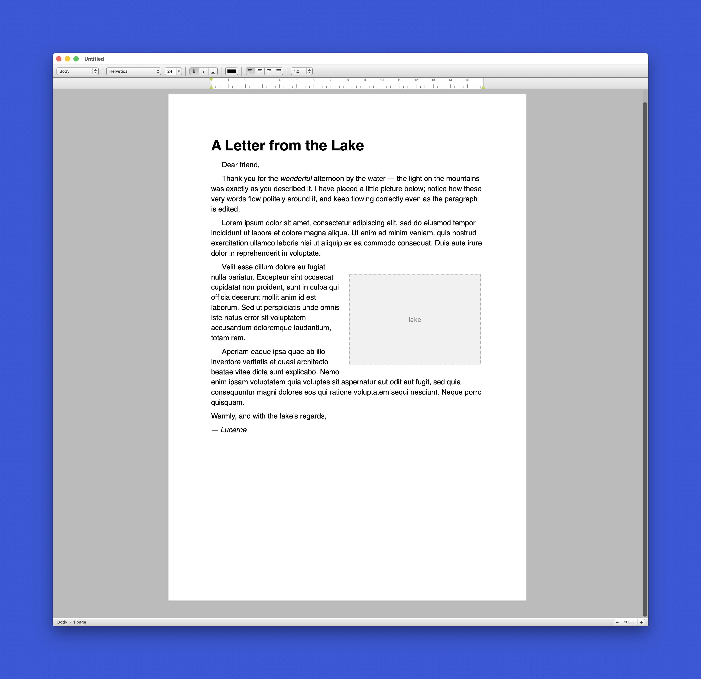

# Lucerne

> [!IMPORTANT]
> LLM disclosure: This codebase was written with substantial help from large language models: AI coding agents working from the [`AGENTS.md`](AGENTS.md) brief in this repo.

*An experimental word processor with only the features I actually need and a classic user interface inspired by ClarisWorks — a small, pleasant tool for writing
letters, with rulers, tabs, and free placement of images.*



**Latest release:** v<!-- version -->0.7.0<!-- /version --> · [Download](https://github.com/L-K-M/Lucerne/releases/latest)

The macOS build is ad-hoc signed and not notarized. After moving **Lucerne**
to Applications, run:

```bash
xattr -dr com.apple.quarantine "/Applications/Lucerne.app"
```

> [!IMPORTANT]
> LLM Disclosure: Much of this code base was written by or with the help of large language models. AI coding agents worked from the [`AGENTS.md`](AGENTS.md) brief in this repo.


## Documents: the `.luce` file

Lucerne saves `.luce` files. A `.luce` file **is a ZIP archive** (it conforms to
`public.zip-archive`), so the recovery story is literally "rename it to `.zip` and
unzip." Inside:

```
document.json   canonical, lossless model — text runs + placed objects (the source of truth)
images/         the placed images as their original files
content.md      a derived, human-readable Markdown copy of the text (write-only escape hatch)
history/        optional dated Markdown backups, thinned with age, for recovery
```

`content.md` is **regenerated on every save and never read back** — it exists so a
future human can recover the words and pictures even if this app is gone. A short
overview is in [`docs/file-format.md`](docs/file-format.md); the complete,
normative specification — enough to build a compatible tool, with a JSON Schema —
is in [`docs/luce-format-spec.md`](docs/luce-format-spec.md).

## Building & running

The macOS UI uses [RigiUI](https://github.com/L-K-M/Rigi) for its classic
controls, window chrome, status bar, searchable pickers, and tear-off behavior.
Its [interface guidelines](https://github.com/L-K-M/Rigi/blob/main/docs/interface-guidelines.md)
define the shared appearance and interactions used by Lucerne and Sion.

Lucerne ships for **macOS** (the original AppKit app) and **Ubuntu/Linux**
(a native Qt port in [`linux/`](linux/README.md) — same features, same `.luce`
files, `.deb`, Flatpak, and AppImage builds on every release). The Linux quick start:

```sh
sudo apt install qt6-base-dev qt6-base-dev-tools libgl1-mesa-dev zlib1g-dev cmake ninja-build
cmake -S linux -B linux/build -G Ninja && cmake --build linux/build
./linux/build/lucerne
```

The rest of this section is the **Mac** build:

> **Requires macOS** (Ventura 13+) and the Swift toolchain (Xcode 15+ or the
> Swift.org toolchain). This repository was authored on Linux, where AppKit is
> unavailable, so the Mac app **cannot be compiled in that environment** —
> build it on a Mac. Compilation is verified by the macOS GitHub Actions
> workflow. (The portable `LucerneCore` target — model + `.luce` IO — does
> build and test everywhere: `swift test` on Linux runs the format-conformance
> suite.)

Quick development run (no app bundle, panels-based open/save work):

```sh
swift run Lucerne
```

Produce a double-clickable `Lucerne.app` (with `.luce` document-type registration):

```sh
Scripts/build.sh           # writes dist/Lucerne.app and reveals it in Finder
Scripts/build.sh --run     # …and launches it
```

`Scripts/build.sh` is the recommended local build: an incremental release build by
default, wrapping `Scripts/make-app.sh` (the bundle assembler), then revealing the
result in Finder. Use `--clean` to rebuild from scratch (wipes `.build/` and `dist/`).

Run the tests (model, Markdown export, geometry — no GUI needed):

```sh
swift test
```

See [`docs/building.md`](docs/building.md) for details and troubleshooting.

## License

The macOS app, the `.deb` and the Flatpak bundle no third-party code: the Mac
app links only macOS system libraries, the `.deb` uses the system's Qt 6, and
the Flatpak uses the KDE runtime from Flathub. The AppImage bundles Qt 6 (GNU
LGPL v3) and other Ubuntu 22.04 libraries, plus the AppImage runtime, which
statically links libfuse (GNU LGPL v2.1); they keep their own licenses. Their
notices ship inside the AppImage: `usr/share/doc/lucerne/Third-Party-Notices.txt`
collects them, each library's Debian `copyright` file is under `usr/share/doc/`,
the license texts those reference are under `usr/share/common-licenses/`, and
`usr/share/doc/lucerne/SOURCES.txt` lists the exact source packages and where to
get them.
